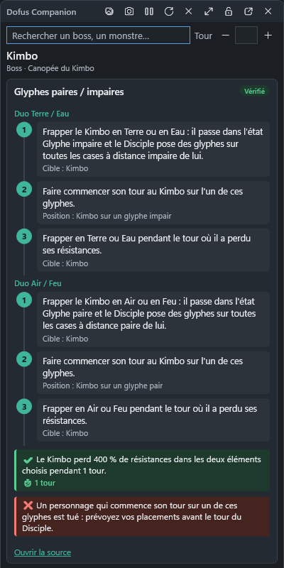
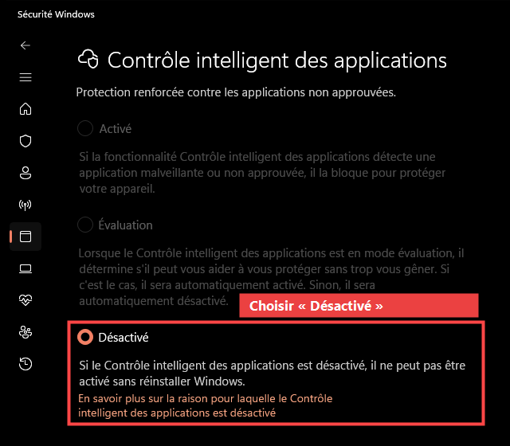

# Dofus Companion

Un compagnon pour **Dofus 3 (Unity)** sous Windows : un petit panneau toujours visible par-dessus le jeu qui
t'explique **comment battre chaque boss** — comment lever son invulnérabilité, dans quel ordre, quels pièges
éviter — avec la source de chaque information.

> Outil indépendant, **non affilié à Ankama ni autorisé par Ankama**. Il ne touche jamais au jeu : il ne lit
> pas sa mémoire, ne modifie aucun fichier, n'envoie aucune touche ni aucun clic. Tu joues, il t'informe.

<p align="center">
  
</p>

Chaque mécanique s'affiche en étapes numérotées : prérequis (avec leur état), actions dans l'ordre, variantes
possibles, résultat attendu et sa durée en vert, pièges mortels en rouge, et un lien vers la source.

---

## Télécharger et lancer

1. Va sur la page **[Releases](https://github.com/nbk265117/goldboss/releases/latest)** (dernière version).
2. Dans **Assets**, télécharge le fichier **`DofusCompanion-<version>-win-x64.zip`** (≈ 80 Mo).
3. Fais un clic droit sur le zip → **Extraire tout…** (par exemple dans `Documents\DofusCompanion`).
4. Ouvre le dossier extrait et double-clique sur **`DofusCompanion.exe`**.

C'est tout : aucune installation, aucun droit administrateur, rien d'autre à télécharger (.NET est inclus).

**Premier lancement :** il peut prendre jusqu'à une minute (installation des données + analyse des fichiers
par Windows). Les suivants prennent environ 1 à 2 secondes.

### Si Windows bloque l'application

L'application n'est **pas encore signée numériquement**. Windows se méfie donc d'elle comme de tout programme
récent téléchargé sur Internet. Selon ton PC, tu verras zéro, un ou deux des cas ci-dessous — chacun a sa
solution.

#### Astuce : débloquer le zip avant de l'extraire (évite le cas 1)

Windows marque les fichiers téléchargés comme « venant d'Internet ». En retirant cette marque avant
d'extraire, le message SmartScreen n'apparaît généralement plus :

1. Clic droit sur **`DofusCompanion-…-win-x64.zip`** → **Propriétés**.
2. Dans l'onglet **Général**, en bas, coche **Débloquer** → **OK**.
3. Ensuite seulement : clic droit → **Extraire tout…**

Ou dans PowerShell, depuis le dossier du téléchargement :
`Unblock-File .\DofusCompanion-*-win-x64.zip`

#### Cas 1 — « Windows a protégé votre ordinateur » (SmartScreen)

Fenêtre bleue au lancement de `DofusCompanion.exe` :

1. Clique sur **Informations complémentaires**.
2. Clique sur **Exécuter quand même**.

Windows ne redemande plus pour cette version.

#### Cas 2 — L'application ne s'ouvre pas du tout (Contrôle intelligent des applications)

Rien ne se passe, ou Windows affiche *« Une stratégie de contrôle d'application a bloqué ce fichier »*. C'est le
**Contrôle intelligent des applications** (*Smart App Control* en anglais), une protection de Windows 11 : il
bloque tout programme non signé qu'il ne connaît pas, et Microsoft indique qu'**il n'existe aucun moyen
d'autoriser une application en particulier**. La seule solution est de le désactiver :

1. Appuie sur la touche **Windows**, tape **Sécurité Windows** et ouvre l'application.
2. Va dans **Contrôle des applications et du navigateur**.
3. Clique sur **Paramètres du Contrôle intelligent des applications**.
4. Choisis **Désactivé** et confirme.
5. Relance `DofusCompanion.exe`.

<p align="center">
  
</p>

> ⚠️ **Lis le texte sous « Désactivé » avant de confirmer.** Depuis la mise à jour d'avril 2026 de Windows 11
> (versions 24H2 et 25H2), Microsoft permet de le réactiver plus tard sans réinstaller Windows. Mais sur
> certains PC, Windows affiche encore *« il ne peut pas être activé sans réinstaller Windows »* (c'est le cas
> sur la capture ci-dessus). Ton antivirus Microsoft Defender continue de te protéger dans tous les cas ;
> seul ce filtre supplémentaire est retiré. C'est ton choix.

Pour savoir si ce contrôle est actif, dans PowerShell :
`Get-ItemPropertyValue 'HKLM:\SYSTEM\CurrentControlSet\Control\CI\Policy' VerifiedAndReputablePolicyState`
→ `0` = désactivé, `1` = activé, `2` = évaluation.

#### Pourquoi c'est bloqué, et ce qui le réglera pour tout le monde

Windows fait confiance aux programmes **signés avec un certificat reconnu**. Le Contrôle intelligent des
applications vérifie la signature de **chaque fichier** de l'application (le `.exe` et toutes les `.dll`) ; un
certificat « fait maison » (auto-signé) ne sert à rien. Les pistes étudiées pour une prochaine version :

| Solution | Coût | Condition |
|---|---|---|
| [SignPath Foundation](https://signpath.org/) | gratuit pour l'open source | licence open source reconnue (OSI), compilation automatisée sur GitHub Actions |
| [Azure Artifact Signing](https://azure.microsoft.com/pricing/details/trusted-signing/) (ex-Trusted Signing) | 9,99 $/mois | pour un particulier : uniquement États-Unis et Canada |
| Certificat de signature classique (OV/EV) | plusieurs centaines d'€/an | auprès d'une autorité reconnue |

Une fois l'application signée, ces étapes ne seront plus nécessaires.

Sources : [FAQ Microsoft sur le Contrôle intelligent des applications](https://support.microsoft.com/en-us/windows/security/threat-malware-protection/smart-app-control-frequently-asked-questions),
[exigences de signature (blog d'un ingénieur sécurité de Microsoft)](https://textslashplain.com/2026/04/28/smart-app-control/),
[réactivation sans réinstallation depuis avril 2026 (Neowin)](https://www.neowin.net/news/you-no-longer-need-clean-install-for-a-free-windows-11-exclusive-performance-boost-feature/).

### Configuration requise

- Windows 10 (version 2004 ou plus récente) ou Windows 11, 64 bits.
- Pour la lecture de captures d'écran : le module Windows « Reconnaissance optique de caractères » en
  français (présent par défaut sur un Windows en français ; sinon *Paramètres › Heure et langue › Langue ›
  Français › Options de langue*).

---

## Utilisation

| Action | Comment |
|---|---|
| Afficher / masquer l'overlay | `Ctrl+Shift+F9`, le bouton dans la fenêtre principale, ou **clic sur l'icône** près de l'heure |
| Icône de notification (à côté de l'heure / dans les icônes cachées `^`) | clic : overlay · double-clic : fenêtre · clic droit : menu et **Quitter** |
| Chercher un boss ou un donjon | Tape son nom dans l'overlay, puis **Entrée** |
| Indiquer le tour actuel | Champ **Tour** de l'overlay (pour les conditions « tour pair », « à partir du tour 7 »…) |
| Lire une capture d'écran | Icône image de l'overlay, ou onglet **Analyse de capture** (fichier, ou `Win+Maj+S` puis **Coller**) |
| Mode compact / détaillé | Icône d'agrandissement de l'overlay |
| Clic traversant (l'overlay ignore la souris) | `Ctrl+Shift+F10` (même raccourci pour reprendre la main) |

Conseils :
- Joue en mode **fenêtré** ou **plein écran fenêtré** pour que l'overlay reste au-dessus du jeu.
- Pour montrer l'overlay sur **Discord**, partage ton **écran entier** (pas seulement la fenêtre Dofus).
- La capture d'écran à la demande est **désactivée par défaut** : *Paramètres › Capture et confidentialité*.
- Les raccourcis se changent dans **Paramètres**.

---

## Images des boss et monstres

L'application affiche une petite image dans les résultats de recherche (overlay et fenêtre principale) et une
grande image dans la fiche du boss. Les images du jeu appartiennent à Ankama : elles **ne sont pas fournies** avec
l'application et ne sont jamais publiées ; tu les télécharges **sur ton PC uniquement**, en une commande, avec
l'outil d'import DofusDB (il faut le [.NET 10 SDK](https://dotnet.microsoft.com/download)) :

```powershell
git clone https://github.com/nbk265117/goldboss.git
cd goldboss
dotnet run --project tools\DofusCompanion.DofusDbImporter -c Release -- --accept-terms --images
```

Puis **redémarre Dofus Companion** : les données et les images sont importées automatiquement.
L'outil fait une requête toutes les 1,5 s (quelques minutes pour les 224 boss ; `--all-images` pour tous les
monstres, beaucoup plus long). Vérifie les conditions d'utilisation de DofusDB avant de l'utiliser (usage personnel).
Sans image, une pastille avec l'initiale du boss s'affiche.

## Ce que contient l'application

- **131 donjons** (dont les 4 dimensions divines), **224 boss** dont **80 cibles d'avis de recherche**.
- **604 mécaniques** rédigées à partir des guides de *[Dofus pour les Noobs](https://www.dofuspourlesnoobs.com)*,
  chacune avec un lien vers sa page et une courte citation vérifiée mot pour mot.
- Chaque mécanique affiche son niveau de fiabilité : **Vérifié** ou **Rapporté par la communauté**.
- Une grande partie des guides date d'avant Dofus 3 : ces mécaniques sont marquées **« à revérifier »**.
- Rien n'est inventé : un boss sans mécanique documentée affiche « Aucune mécanique documentée ».

Tu peux ajouter tes propres mécaniques (onglet **Connaissances**) ou importer un fichier de connaissances.

## Vie privée

- Aucune connexion internet, aucune télémétrie, aucun compte demandé. Seul un clic sur « Ouvrir la source »
  ouvre la page du guide dans ton navigateur.
- Les captures sont analysées sur ton PC et ne sont pas conservées (sauf si tu l'actives).
- Tes données sont dans `%LOCALAPPDATA%\DofusCompanion`.

## Nouveautés

Voir [CHANGELOG.md](CHANGELOG.md). Version 0.2.0 : nouveau style des étapes, la fiche d'un donjon affiche les
mécaniques de ses boss, overlay visible dans les partages Discord/OBS.

## Mettre à jour / désinstaller

- **Mettre à jour :** télécharge la nouvelle version et remplace le dossier. Tes données sont conservées.
- **Désinstaller :** supprime le dossier de l'application, et `%LOCALAPPDATA%\DofusCompanion` pour effacer
  aussi tes données.

---

## Pour les développeurs

Prérequis : [.NET 10 SDK](https://dotnet.microsoft.com/download).

```powershell
git clone https://github.com/nbk265117/goldboss.git
cd goldboss
.\scripts\build.ps1      # compile (Release)
.\scripts\test.ps1       # lance les tests
.\scripts\publish.ps1    # crée le zip dans artifacts\publish
```

Documentation technique : [`docs/`](docs) — architecture, format des connaissances, tests, limites connues.

---

Les textes des mécaniques sont reformulés à partir des guides de *Dofus pour les Noobs*, avec attribution et
lien vers chaque page. DOFUS est une marque d'Ankama Games. Aucune ressource graphique du jeu n'est incluse.

---

<p align="center">Développé avec ❤️ en 2026 par <strong>AYOUB YOUB JOE</strong></p>
